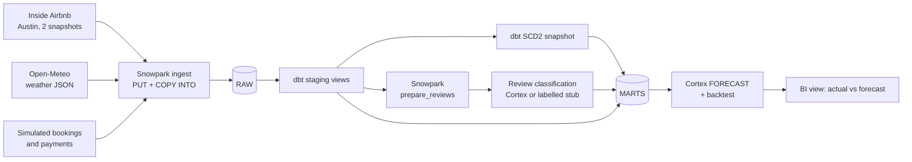

# StayPulse Lite

Guest-experience and demand intelligence for a travel marketplace, built end to end on Snowflake. It loads real
Airbnb listings and reviews for Austin, TX, adds weather and simulated bookings, models them with dbt, uses
Snowpark for the heavy lifting and Cortex for classification and forecasting, and runs the whole thing in Docker
or on a schedule in Airflow.

It is a reference project sized for a Snowflake free trial. Every command below was run against a real trial
account, and the numbers in [Results](#results) come from those runs.

## What it demonstrates

| Area | Where to look |
| --- | --- |
| Snowflake RBAC, key-pair service user, managed-access schemas | [`snowflake_setup.sql`](snowflake_setup.sql) |
| FinOps: XSMALL warehouses with 60 s auto-suspend, resource monitor, statement timeout | [`snowflake_setup.sql`](snowflake_setup.sql) |
| Idempotent loading: internal stage, `PUT`, `COPY INTO`, `INFER_SCHEMA`, `VARIANT` + `LATERAL FLATTEN` | [`snowpark_jobs/ingest.py`](snowpark_jobs/ingest.py), [`stg_weather.sql`](dbt_project/models/staging/stg_weather.sql) |
| Snowpark pushdown (lazy DataFrames, only counts return to Python) | [`snowpark_jobs/prepare_reviews.py`](snowpark_jobs/prepare_reviews.py) |
| dbt: incremental `MERGE`, `delete+insert`, SCD2 snapshot, generic and singular tests | [`dbt_project/`](dbt_project) |
| Cortex AI with a labelled fallback, and `SNOWFLAKE.ML.FORECAST` with a backtest | [`classify_review.sql`](dbt_project/macros/classify_review.sql), [`sql/30_forecast.sql`](sql/30_forecast.sql) |
| Time Travel, zero-copy clones, Query Profile diagnosis | [`sql/10_time_travel_and_clone.sql`](sql/10_time_travel_and_clone.sql), [`sql/20_query_profile_lab.sql`](sql/20_query_profile_lab.sql) |
| Airflow + Astronomer Cosmos, dbt and Snowpark in isolated virtualenvs | [`airflow/dags/staypulse_daily.py`](airflow/dags/staypulse_daily.py) |
| Reproducible Docker runs with a logged Makefile | [`Makefile`](Makefile), [`docker-compose.yml`](docker-compose.yml) |

## Architecture



Airflow runs the same steps in order, with Cosmos turning every dbt model and its tests into a task of its own:

```
load_raw -> dbt_stage -> snapshot_bootstrap -> prepare_reviews -> dbt_core -> forecast
```

| Schema | Contents |
| --- | --- |
| `RAW` | Loaded files, untouched: listings, reviews, bookings, payments, weather JSON |
| `STAGING` | Typed, cleaned views over RAW (duplicates removed where the source has them) |
| `INTERMEDIATE` | `REVIEWS_PREPARED` (Snowpark) and `INT_REVIEWS_CLASSIFIED` (dbt) |
| `SNAPSHOTS` | `SNAP_LISTING`, the SCD2 history of listings |
| `MARTS` | `DIM_LISTING`, `FCT_BOOKING`, `FCT_DAILY_BOOKINGS`, `FCT_REVIEW_ISSUE`, forecast tables and views |

## Quick start

Prerequisites: Docker with Compose v2, GNU Make, `openssl`, and a Snowflake account (the free trial works).

**1. Create the service-user key pair.** The private key never leaves `secrets/`, which is gitignored.

```bash
mkdir -p secrets && cd secrets
openssl genrsa 2048 | openssl pkcs8 -topk8 -inform PEM -v2 aes-256-cbc -out pipeline_rsa_key.p8   # choose a passphrase
openssl rsa -in pipeline_rsa_key.p8 -pubout -out pipeline_rsa_key.pub
grep -v 'PUBLIC KEY' pipeline_rsa_key.pub | tr -d '\n'; echo       # the public key body for step 2
cd ..
```

**2. Set up Snowflake.** In a Snowsight worksheet, run [`snowflake_setup.sql`](snowflake_setup.sql) after replacing
`<YOUR_SNOWFLAKE_USERNAME>` (twice) and `<PUBLIC_KEY_BODY>`. If your login name is lowercase, wrap it in double
quotes. Then run [`snowflake_smoke_test.sql`](snowflake_smoke_test.sql). It confirms what each role can do, and
the statements marked `EXPECT FAIL` must be rejected.

**3. Configure the environment.**

```bash
cp .env.example .env     # fill in SNOWFLAKE_ACCOUNT and SNOWFLAKE_KEY_PASSPHRASE
```

**4. Run everything.**

```bash
make pipeline            # preflight, build, login check, ingest, dbt, Snowpark, dbt, forecast
make demo                # Airflow + Cosmos on http://localhost:8080 (admin / admin)
make airflow-run         # run the whole DAG once through Airflow
```

The first `make pipeline` also builds the runner image, which adds a few minutes. After that a full run takes about
four minutes on a trial account, and nearly half of that is the two forecast model trainings. It is safe to repeat.

## Make targets

Run `make help` for the full list. The ones you will use most:

| Target | What it does |
| --- | --- |
| `pipeline` | Everything end to end in the runner container, with a summary table at the end |
| `doctor` | Preflight: Docker, `.env`, key permissions, config consistency, secrets are gitignored |
| `ingest` | Download, `PUT`, `COPY INTO` RAW. A second run loads zero rows |
| `reload-raw` | Truncate RAW and reload it from the stage (asks first, `CONFIRM=yes` skips the prompt) |
| `dbt-staging`, `dbt-core`, `dbt-test` | The dbt stages, each with its tests |
| `forecast` | Cortex FORECAST with a backtest, and a seasonal baseline if Cortex ML is unavailable |
| `demo` | Start Postgres, Airflow init, webserver and scheduler, wait until healthy, print URL and login |
| `airflow-errors`, `airflow-run`, `airflow-down` | DAG import check, one full DAG run, stop the stack |
| `shell` | Interactive shell inside the runner container |

Every step writes a timestamped log to `logs/<run-id>/<step>.log`. `logs/latest` points at the newest run, and a
step, status and seconds table is printed at the end of each pipeline run and saved as `summary.txt`. A failing
step prints the tail of its own log and stops the run.

## Design decisions

- **Key-pair auth for a service user.** The pipeline logs in as `SVC_PIPELINE` (`TYPE=SERVICE`) with an encrypted
  private key. No passwords are stored anywhere, and the user has no human login.
- **Three roles with managed-access schemas.** `SP_LOADER` writes RAW, `SP_TRANSFORMER` builds everything
  downstream, `SP_ENGINEER` is for humans and drills. Schema owners cannot hand out grants on their own.
- **Cost guardrails.** Two XSMALL warehouses suspend after 60 seconds, a monthly resource monitor caps warehouse
  credits, and the statement timeout is one hour instead of Snowflake's two-day default. Resource monitors do not
  cover AI and serverless spend, so the Cortex steps are deliberately small (300 reviews, one forecast series).
- **Idempotent ingest.** Files are only `PUT` when the stage folder is empty, and `COPY INTO` skips files it has
  already loaded, so reruns are free. Listings are loaded from two snapshots so there is real history to model.
- **SCD2 without a change feed.** Inside Airbnb publishes snapshots, not changes. The ephemeral model
  `int_listings_asof` derives an `effective_at` per listing version (gaps and islands), and the dbt snapshot uses
  the timestamp strategy with `hard_deletes: invalidate`. Replaying the older snapshot after the newer one would
  close listings that only exist in the newer file, so `bootstrap_snapshot.py` replays it only when the history
  table is empty.
- **Two incremental strategies, on purpose.** `fct_booking` uses `MERGE` with a three-day lookback because bookings
  change after creation (cancellations). `fct_daily_bookings` uses `delete+insert` because each day is recomputed
  as a whole.
- **Snowpark for pushdown.** `prepare_reviews` cleans, deduplicates and samples 653k reviews entirely inside
  Snowflake. Only a row count returns to Python.
- **Cortex with a fallback.** Classification goes through a macro with three modes: `ai_classify`, `ai_complete`
  and `keyword_stub`. The stub labels every row with `classifier = 'keyword_stub'`, so stub output can never be
  mistaken for model output. Forecasting falls back to a seasonal-naive baseline if Cortex ML is unavailable.
- **Airflow without dependency fights.** The Airflow image installs only Airflow and Cosmos, pinned with Airflow's
  constraints file. Snowpark jobs and dbt each get their own virtualenv inside the image and are called as
  subprocesses, so their versions never conflict with Airflow's.

## Results

From a real run against a Snowflake trial account (Austin, snapshots 2026-06-22 and 2026-09-17):

| Measure | Value |
| --- | --- |
| RAW rows loaded | listings 22,406 (two snapshots), reviews 653,461, bookings 5,008, payments 5,000, weather 1 |
| Second ingest run | 0 rows loaded in every table |
| Marts | `DIM_LISTING` 11,111, `FCT_BOOKING` 5,000, `FCT_DAILY_BOOKINGS` 150, `FCT_REVIEW_ISSUE` 300 |
| SCD2 history | 21,621 versions in `SNAP_LISTING` |
| dbt build (core stage) | 19 of 19 nodes passed (models, snapshot and tests), 14.4 s |
| Forecast | 14 days ahead, backtest MAPE 19.3 % (`cortex_forecast`) |
| `make pipeline` | all 10 steps passed, 442 s total including a 184 s first image build, forecast 160 s |
| Airflow DAG | all tasks succeeded in one `airflow dags test` run, 425 s |

The bookings and payments are simulated, so the forecast accuracy says something about the pipeline and the model
setup, not about real demand.

## Known limitations

- **Cortex LLM functions are blocked on trial accounts.** `AI_CLASSIFY` and `AI_COMPLETE` return error 399258 until
  a payment method is added, so classification defaults to the labelled keyword stub. After enabling AI, delete the
  rows in `INTERMEDIATE.INT_REVIEWS_CLASSIFIED` and run `make pipeline CORTEX_FN=ai_classify`. `FORECAST` works on
  the trial.
- **dbt-core is pinned to a beta (`1.13.0b1`)** because that is the version the project was verified with. Pins
  live in [`docker/requirements.dbt.txt`](docker/requirements.dbt.txt).
- **Local Airflow only.** The stack binds to `127.0.0.1`, uses `LocalExecutor` and a throwaway admin login. It is a
  demo, not a deployment.
- **Two snapshots, one city.** Enough to show SCD2 and incremental logic, not enough for seasonality claims.

## Troubleshooting

| Symptom | Cause and fix |
| --- | --- |
| `JWT token is invalid` | The public key is not attached to `SVC_PIPELINE`, or you regenerated the key. Run `ALTER USER SVC_PIPELINE SET RSA_PUBLIC_KEY='...'` with the new body. |
| `Password was not given but private key is encrypted` | `SNOWFLAKE_KEY_PASSPHRASE` is empty in `.env`. |
| `User '...' does not exist` during setup | Your login name is lowercase. Quote it: `"yourname"`. |
| Open-Meteo `ConnectTimeout` | Transient. The weather fetch retries four times with backoff. |
| `AI_CLASSIFY is not available for trial accounts` | Expected on a trial. See the limitations above. |
| `make demo` stops at `airflow-init` | The wait step prints the init and webserver logs. The full output is in `logs/<run-id>/demo-wait.log`. |

## Repository layout

```
snowflake_setup.sql          roles, warehouses, monitor, stage (run once in Snowsight)
snowflake_smoke_test.sql     verifies the setup
snowpark_jobs/               ingest, bookings generator, review preparation, forecast runner, helpers
dbt_project/                 staging, intermediate, marts, snapshot, macros, tests
sql/                         Time Travel and clone drill, Query Profile lab, Cortex FORECAST
airflow/dags/                the daily DAG (Cosmos)
docker/                      runner and Airflow images, pinned requirements
docker-compose.yml           profiles: pipeline (runner) and airflow (Postgres, init, webserver, scheduler)
Makefile, scripts/           logged targets, per-step wrapper, summary and preflight scripts
docs/numbers.md              figures to quote, with where each one comes from
```

## Data and credit

- Listings and reviews: [Inside Airbnb](https://insideairbnb.com/get-the-data/), Austin, Texas, collected on
  2026-06-22 and 2026-09-17, licensed under CC BY 4.0. The data is downloaded once into the gitignored `data/`
  folder and is not redistributed in this repository.
- Weather: [Open-Meteo](https://open-meteo.com/en/docs/historical-weather-api) historical weather API, CC BY 4.0.
- Bookings and payments are simulated by [`snowpark_jobs/generate_bookings.py`](snowpark_jobs/generate_bookings.py)
  with a fixed seed and are not real transactions.

## License

[MIT](LICENSE) for the code. The data keeps the licences of its sources, listed above.
